# YouPlayer Server

Serveur musical personnel et auto-hébergé pour réunir YouTube, Spotify et vos
fichiers audio dans une seule interface web.

## 📋 Sommaire

- [✨ Ce que vous pouvez faire](#ce-que-vous-pouvez-faire)
- [🖼️ Aperçu](#aperçu)
- [📦 Installation](#installation)
- [🚀 Premier démarrage](#premier-démarrage)
- [🔄 Mise à jour](#mise-à-jour)
- [🛠️ Développement](#développement)
- [📚 Documentation](#documentation)
- [📄 Licence](#licence)
- [⚠️ Avertissement](#avertissement)

## Ce que vous pouvez faire

- rechercher de la musique sur YouTube et Spotify ;
- créer des playlists et ajouter vos fichiers audio ;
- exporter et importer vos playlists en JSON depuis les paramètres (liens YouTube et Spotify, sans les fichiers audio locaux) ;
- ajouter les morceaux individuels en tête de playlist, sans inverser les imports ;
- ouvrir la fiche Spotify d’un artiste depuis les listes et le lecteur ;
- afficher les paroles depuis le lecteur, avec synchronisation ou texte seul ;
- retrouver votre file et votre position de lecture sur un autre appareil ;
- passer automatiquement les passages non musicaux YouTube avec SponsorBlock ;
- gérer plusieurs comptes, chacun avec sa bibliothèque privée.

Spotify fournit des références musicales. La disponibilité d'un titre sur Spotify
ne garantit pas qu'une source audio correspondante sera trouvée.

Les liens artistes conservent les identifiants Spotify disponibles. Pour un titre
YouTube ou une ancienne entrée, YouPlayer cherche une correspondance sur le titre
et l’artiste ; en cas de doute, il affiche les résultats à choisir.

Le bouton **Paroles** lance une recherche sur [LRCLIB](https://lrclib.net/docs.txt),
sans clé API, en transmettant le titre et l’artiste. Tant que le panneau reste
ouvert, le morceau suivant déclenche une nouvelle recherche. Les paroles suivent
la position audio uniquement si les durées diffèrent de deux secondes au maximum ;
sinon, le texte reste disponible sans défilement automatique. Un réglage de décalage
et la case **Suivre la lecture** permettent de corriger ou désactiver le suivi.
Pendant le suivi, la ligne chantée reste au centre du panneau et le texte défile
automatiquement, y compris pour la première et la dernière ligne. Ouvrir les
paroles affiche directement leur zone de lecture ; le centrage s’adapte à la
taille de l’écran et aux changements de position.
Une durée proche ne garantit pas un alignement parfait : les intros, versions live
et montages peuvent différer. Aucun étirement des paroles n’est appliqué.

Si LRCLIB ne trouve pas de texte, YouPlayer essaie les sous-titres de la vidéo
effectivement utilisée pour l’audio, via yt-dlp. Les sous-titres manuels sont
prioritaires ; les transcriptions automatiques sont identifiées comme telles et
peuvent contenir des erreurs. Leur suivi utilise les horodatages de cette vidéo,
sans imposer la durée de la version Spotify. La source vidéo est conservée dans
le cache privé de la session ; un ancien fichier audio sans cette référence ne
permet pas ce repli tant qu’il n’a pas été téléchargé à nouveau. Certaines vidéos
n’ont pas de sous-titres accessibles ou leur récupération peut être refusée par
YouTube. La musique continue même si la recherche de sous-titres échoue.

Si ces deux sources ne fournissent aucun texte, YouPlayer interroge
[lyrics.ovh](https://github.com/NTag/lyrics.ovh), sans clé API, avec le titre et
l’artiste. Ce dernier recours fournit uniquement du texte : le suivi automatique
et le décalage sont désactivés, et la source est indiquée dans le lecteur. Il
fonctionne aussi quand un ancien cache audio n’a pas de référence vidéo. Les
réponses sont mises en cache ; les requêtes sont limitées et les erreurs du
fournisseur n’interrompent pas la musique.

## Aperçu

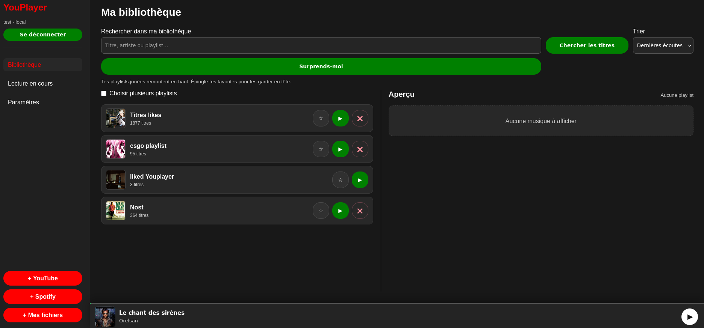

<details>
<summary>Voir les autres écrans</summary>

### Connexion

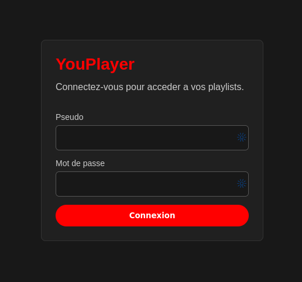

### Recherche YouTube

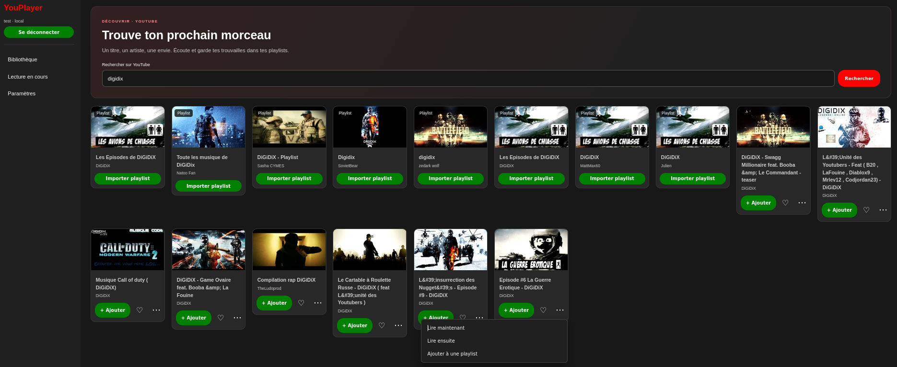

### Recherche Spotify

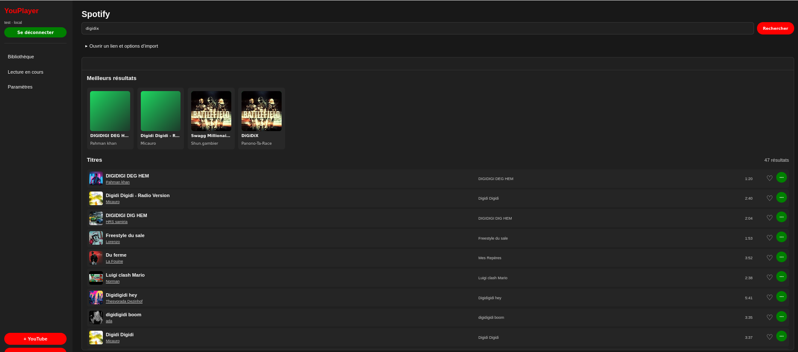

### Fiche artiste Spotify

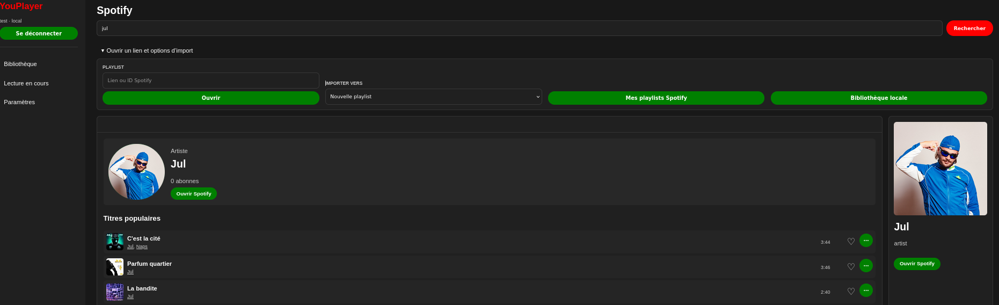

### Lecture en cours

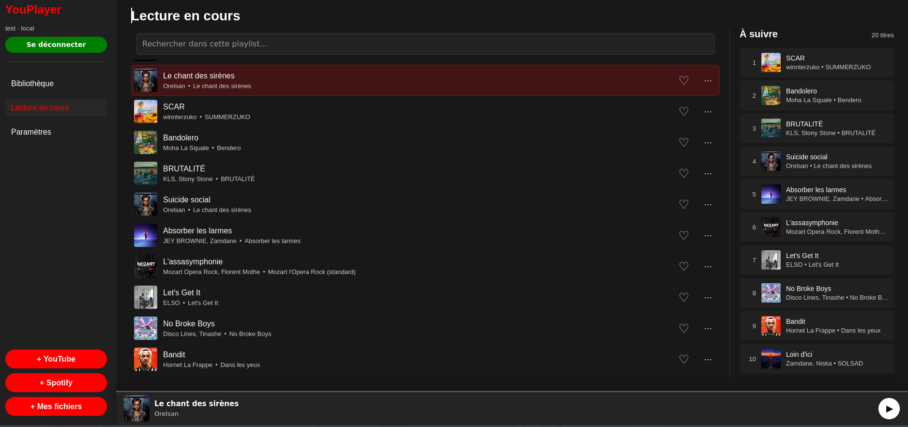

### Import d'un fichier audio

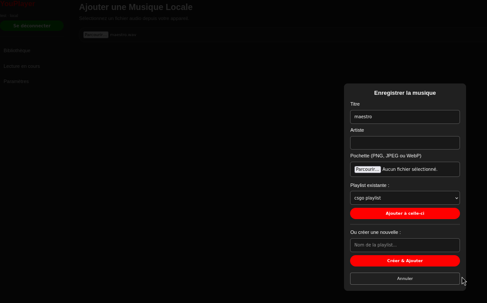

### Paramètres utilisateur

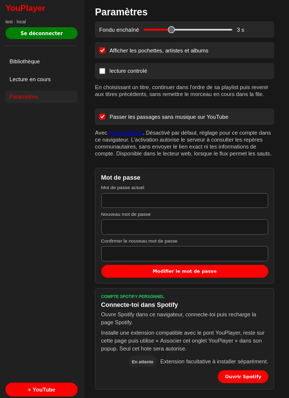

### Intégrations administrateur

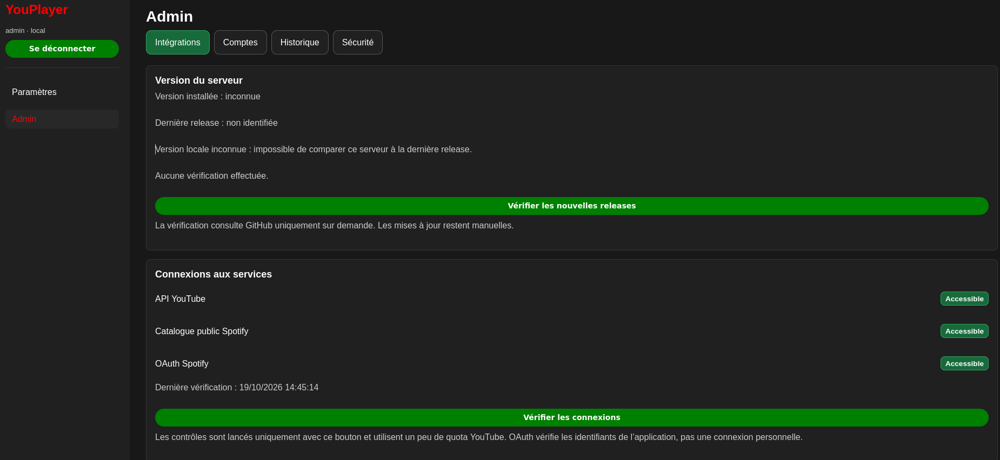

### Gestion des comptes

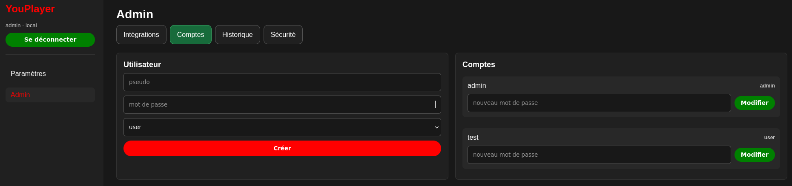

### Sécurité des dépendances

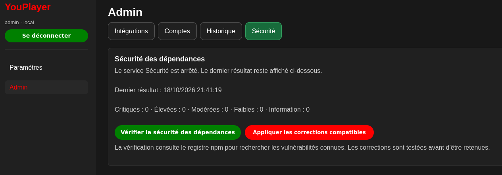

</details>

## Installation

YouPlayer fonctionne sur Linux AMD64 ou ARM64 avec :

- Podman et `podman-compose` ; ou
- Docker Engine et le plugin `docker compose`.

Node.js, npm et Go ne sont pas nécessaires.

1. Téléchargez `youplayer-install.tar.gz` et `SHA256SUMS` depuis la même
   [release officielle](https://github.com/RaliteJ/YouPlayer_Server/releases).
2. Dans un dossier vide et permanent, exécutez :

```bash
sha256sum -c SHA256SUMS
mkdir youplayer
tar -xzf youplayer-install.tar.gz -C youplayer
cd youplayer
./install.sh podman
```

Avec Docker, remplacez la dernière commande par `./install.sh docker`.

L'installateur demande le compte administrateur, génère les secrets, télécharge
les images puis démarre les services. N'utilisez pas `sudo` et n'installez pas
YouPlayer dans `/tmp`.

Le guide complet des prérequis et du dépannage se trouve dans [INSTALL.md](INSTALL.md).

## Premier démarrage

1. Ouvrez `https://ADRESSE_DU_SERVEUR:8443`.
2. Connectez-vous avec le compte **admin** créé pendant l'installation.
3. Créez un compte **user** depuis l'administration.
4. Utilisez ce compte **user** pour écouter de la musique.

Le certificat initial est autosigné : votre navigateur peut afficher un
avertissement. Configurez un domaine et un certificat valide avant d'exposer le
serveur sur Internet.

Les intégrations YouTube et Spotify sont facultatives et se configurent dans
`.env`. Ne partagez jamais ce fichier, les journaux, les sauvegardes ou les données
des utilisateurs.

## Mise à jour

Pour une installation issue d'une release :

1. ouvrez **Admin → Intégrations → Version du serveur** ;
2. cliquez sur **Vérifier les nouvelles releases** ;
3. vérifiez la version proposée, puis cliquez sur **Installer la version**.

Rien n'est vérifié ni installé automatiquement. Ne lancez jamais `down -v` : cette
commande supprime les volumes. Consultez [UPDATES.md](UPDATES.md) avant une mise à
jour ou une récupération.

## Développement

Un clone Git sert au développement ; `install.sh` fonctionne uniquement depuis
l'archive d'une release officielle.

```bash
test -f .env || cp .env.example .env
# Remplacez ensuite les valeurs descriptives de .env.
podman-compose -p youplayer-server up -d --build
```

L'interface locale est disponible sur <https://localhost:8443>.

Pour installer les dépendances et lancer les tests :

```bash
npm --prefix src ci
npm --prefix src test
```

## Documentation

- [Installation](INSTALL.md)
- [Mises à jour et récupération](UPDATES.md)
- [Exploitation, sauvegarde et restauration](PRODUCTION.md)
- [Règles de contribution](AGENTS.md)

## Licence

Le code de YouPlayer Server est distribué sous licence
[GNU AGPL version 3](LICENSE). Toute version modifiée accessible à des utilisateurs
par un réseau doit leur permettre d'obtenir son code source correspondant.

Copyright © 2026 RaliteJ.

Cette licence ne couvre pas les marques, pochettes, médias et autres contenus de
tiers affichés par les services musicaux ou dans les captures d'écran.

## Avertissement

YouPlayer Server est créé et maintenu par [RaliteJ](https://github.com/RaliteJ).
Il est fourni sans garantie et n'est ni affilié, ni approuvé, ni sponsorisé par
Spotify, YouTube ou Google.

Vous restez responsable du respect de la loi, du droit d'auteur et des conditions
d'utilisation des services tiers.
